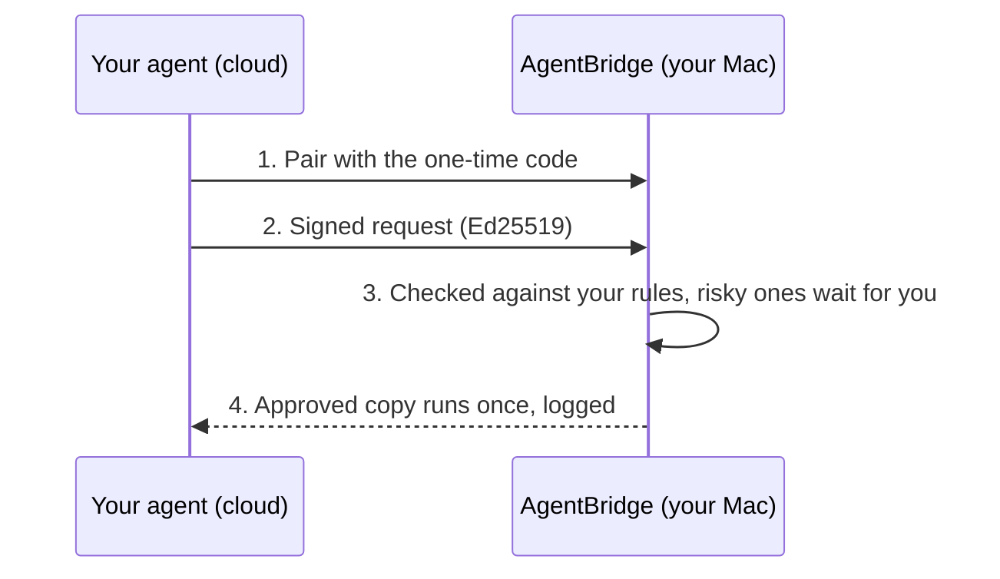

<div align="center">

<picture>
  <source media="(prefers-color-scheme: dark)" srcset="assets/banner-dark.png">
  
</picture>

# AgentBridge

**Connect your cloud AI agent to your Mac in one command.** It can run Terminal commands, work with your local files and folders, even build and run apps in the iOS simulator - and anything risky waits for your yes. What you approve is exactly what runs.

[](LICENSE)
[]()
[](https://github.com/ndpvt-web/agent-bridge/releases/latest)
[](https://github.com/ndpvt-web/agent-bridge/stargazers)
[]()

[Quick Start](#quick-start) · [Approvals](#you-approve-what-matters) · [Two Modes](#two-modes) · [Security](#how-it-stays-safe) · [Docs](docs)

**Works with your agent**

<table>
  <tr>
    <td align="center"><br><sub>Instinct</sub></td>
    <td align="center"><br><sub>Claude</sub></td>
    <td align="center"><br><sub>ChatGPT</sub></td>
    <td align="center"><br><sub>Cursor</sub></td>
    <td align="center"><br><sub>Meta</sub></td>
  </tr>
</table>

</div>

AgentBridge is a small app that lives on your Mac and lets your cloud AI agent - Claude, ChatGPT, Cursor, or any agent that can make HTTPS requests - actually use your Mac: execute commands in Terminal, read and write your local files and folders, run scripts, even drive apps like the iOS simulator.

You stay in charge. In **SAFE** mode, everyday read-only work runs freely inside a folder you choose. Anything risky - deleting files, changing settings, reaching outside that folder - stops and waits for your yes at your own keyboard. In **FULL** mode the agent can do anything, as you. Nothing can approve itself, and every action is signed and logged, so you can always see exactly what happened.

## Quick start

One command sets everything up. No Homebrew, no npm, no account - about a minute.

1. **Open Terminal** - press **Command+Space**, type `Terminal`, press **Return**.
2. **Paste the command for the version you want** (tip: use the copy button at the top-right of the code box), press **Return**:

   **SAFE** (recommended - everyday work runs freely, anything risky waits for your yes):

   ```bash
   curl -fsSL https://github.com/ndpvt-web/agent-bridge/releases/latest/download/install.sh | bash
   ```

   **FULL** (the agent can do anything, as you - only if you trust it completely):

   ```bash
   curl -fsSL https://github.com/ndpvt-web/agent-bridge/releases/latest/download/install.sh | bash -s -- --mode full
   ```

   Done when you see **AGENTBRIDGE INSTALLED**. If your shell later says `command not found`, run `export PATH="$HOME/.local/bin:$PATH"` once and try again.
3. **Connect your agent** - run `agent-bridge pair`. It prints two things: a **tunnel URL** (a temporary, encrypted address that lets your cloud agent reach your Mac through a Cloudflare tunnel) and a **one-time pairing code**. Paste both into your agent's chat, like this:

   ```
   Use my AgentBridge to work on my Mac.
   Tunnel: https://your-words-here.trycloudflare.com
   Pairing code: 123456
   Protocol: https://github.com/ndpvt-web/agent-bridge/blob/main/docs/protocol.md
   ```

   The agent connects itself. Approvals always happen on your Mac.

## You approve what matters

Risky actions never run silently - they wait for your decision at the keyboard:

<p align="center">
  
</p>

The yes has to come from your keyboard, on your Mac. Nothing else - not a pipe, not a script, not the agent - can approve for you.

## Two modes

| Mode | What the agent can do |
| --- | --- |
| **SAFE** (default) | Work inside one folder you choose. Everyday read-only commands run freely; anything risky waits for your approval on the Mac. |
| **FULL** | Anything, as you. No jail, no approvals. Only if you trust the agent completely. |

SAFE is the default and never changes silently. Switching to FULL shows one clear warning, asks you to confirm, and logs the switch:

```bash
agent-bridge mode full    # warns, asks you to confirm, logs the switch
agent-bridge mode safe    # back to safe
```

## How it works



## Everyday commands

```bash
agent-bridge status            # running? which mode? who is connected
agent-bridge pending           # requests waiting for your decision
agent-bridge approve <id>      # say yes (shows exactly what runs, first)
agent-bridge deny <id>         # say no
agent-bridge agents            # who is connected
agent-bridge revoke <name>     # cut an agent off
agent-bridge audit             # tamper-evident log of everything
agent-bridge audit --verify    # check the log's integrity
agent-bridge trash             # browse and restore deleted files
~/agent-bridge/uninstall.sh    # remove the bridge (keeps your files)
```

## How it stays safe

1. **Signed requests** - every call is Ed25519-signed by a paired agent key. No key, no access. Captured requests can't be replayed.
2. **Strict allowlist** - 21 read-only programs with per-program argument rules. Everything else needs your approval.
3. **Filesystem jail** - realpath-checked; symlink escapes and writes through links are refused.
4. **Frozen approvals** - named files are copied into a private snapshot at request time, and the run executes the copies. Approvals work once, expire in 120 seconds, and default to deny.
5. **Tamper-evident audit log** - hash-chained; edits to history show up as tampering.

Install downloads are version-pinned and SHA-256-verified, fail-closed, with no unverified system-binary fallback.

## Why AgentBridge

- **You stay in charge** - risky commands, deletions, and shell access wait for your yes on the Mac itself
- **No bait-and-switch** - approving a command freezes a private copy of every file it names, and the run executes the copies
- **Your files stay in a jail** - the agent sees only the folder you choose; writes are versioned, deletes go to a trash folder
- **Every action is logged** - a tamper-evident audit trail of who did what, when
- **Zero dependencies** - no Homebrew, no npm install; the installer sets up a pinned, hash-verified Node for you

## Limitations and roadmap

- **macOS only, for now** - the jail, trash folder, and installer target macOS.
- **Native MCP adapter not built yet** - AgentBridge already speaks MCP-style JSON-RPC (`initialize`, `tools/list`, `tools/call`) over signed HTTPS; a plug-and-play `mcp.json` adapter is on the roadmap.
- **Free tunnel URLs rotate** - when a quick Cloudflare tunnel restarts it gets a fresh address; run `agent-bridge pair` again to hand the agent the new one.

## Docs

[Security policy](SECURITY.md) · [Threat model](docs/threat-model.md) · [Protocol for agent developers](docs/protocol.md)

## License

MIT
