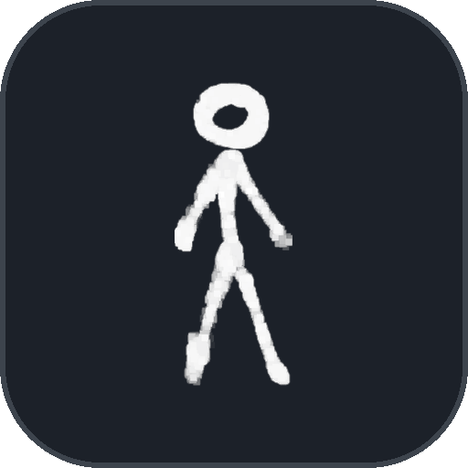
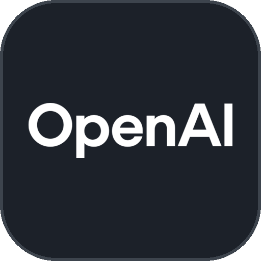
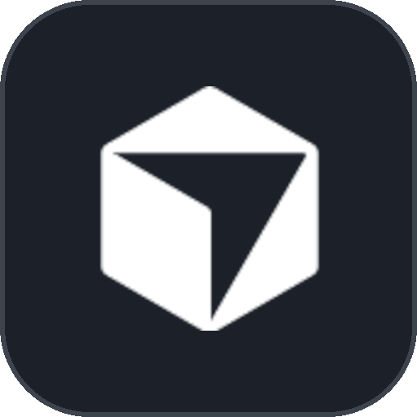
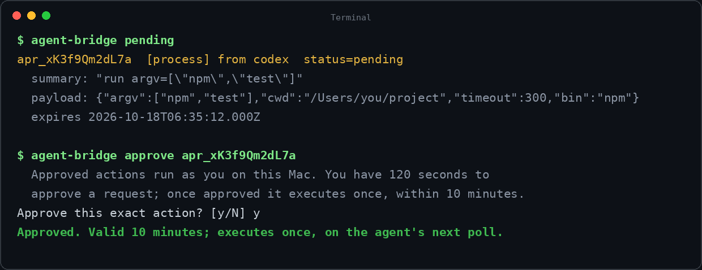
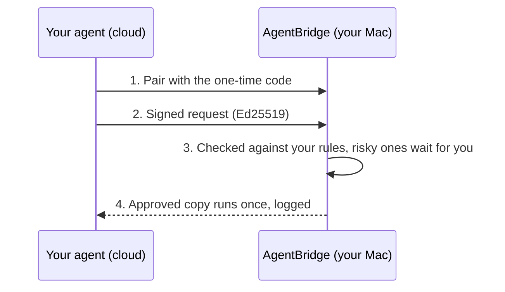

<div align="center">

<picture>
  <source media="(prefers-color-scheme: dark)" srcset="assets/banner-dark.png">
  
</picture>

# AgentBridge

**Let your Instinct, Meta Muse, or Cursor cloud agent run Terminal commands and use local files on your Mac - safely.** Works with any cloud AI agent that can make HTTPS requests; anything risky waits for your yes.

[](LICENSE)
[]()
[](https://github.com/ndpvt-web/agent-bridge/releases/latest)
[](https://github.com/ndpvt-web/agent-bridge/stargazers)
[]()

[Quick Start](#quick-start) · [Two Modes](#two-modes) · [Security](#how-it-stays-safe) · [Docs](docs)

<table>
  <tr>
    <td align="center"><br><sub>Instinct</sub></td>
    <td align="center"><br><sub>Claude</sub></td>
    <td align="center"><br><sub>ChatGPT</sub></td>
    <td align="center"><br><sub>Cursor</sub></td>
    <td align="center"><br><sub>Meta</sub></td>
  </tr>
</table>

</div>

**What your agent can do on your Mac:** run Terminal commands and scripts, read and write local files and folders, even build and run apps in the iOS simulator. Anything risky - deleting files, changing settings, reaching outside your chosen folder - stops and waits for your yes at your own keyboard.

## Quick start

One command sets everything up. No Homebrew, no npm, no account - about a minute.

1. **Open Terminal** - press **Command+Space**, type `Terminal`, press **Return**.
2. **Paste the command for the version you want** (tip: use the copy button at the top-right of the code box), press **Return**:

   **SAFE** (recommended - everyday work runs freely, anything risky waits for your yes):

   ```bash
   curl -fsSL https://github.com/ndpvt-web/agent-bridge/releases/latest/download/install.sh | bash
   ```

   **FULL** (the agent can do anything, as you - only if you trust it completely):

   ```bash
   curl -fsSL https://github.com/ndpvt-web/agent-bridge/releases/latest/download/install.sh | bash -s -- --mode full
   ```

   Done when you see **AGENTBRIDGE INSTALLED**. If your shell later says `command not found`, run `export PATH="$HOME/.local/bin:$PATH"` once and try again.
3. **Connect your agent** - run `agent-bridge pair`. It prints a **tunnel URL** (a temporary, encrypted address your agent uses to reach your Mac) and a **one-time pairing code**. Paste both into your agent's chat:

   ```
   Use my AgentBridge to work on my Mac.
   Tunnel: https://your-words-here.trycloudflare.com
   Pairing code: 123456
   Self-heal link: https://webhook.site/token/your-id/requests?sorting=newest
   Protocol: https://github.com/ndpvt-web/agent-bridge/blob/main/docs/protocol.md
   ```

   The agent connects itself. Approvals always happen on your Mac. If the tunnel ever restarts and gets a new address, the new one shows up at the self-heal link automatically - the agent checks it and reconnects, you never paste again. (The link is a free webhook.site inbox, no account; it carries only the tunnel address, never keys or data.)

## You approve what matters

Risky actions wait for your decision at the keyboard - nothing else can approve for you:

<p align="center">
  
</p>

## Two modes

| Mode | What the agent can do |
| --- | --- |
| **SAFE** (default) | Work inside one folder you choose; anything risky waits for your approval. |
| **FULL** | Anything, as you. No jail, no approvals. |

Switch anytime - changing to FULL warns, asks you to confirm, and logs the switch:

```bash
agent-bridge mode full
agent-bridge mode safe
```

## How it works



## Everyday commands

```bash
agent-bridge status            # running? which mode? who is connected
agent-bridge pending           # requests waiting for your decision
agent-bridge approve <id>      # say yes (shows exactly what runs, first)
agent-bridge deny <id>         # say no
agent-bridge agents            # who is connected
agent-bridge revoke <name>     # cut an agent off
agent-bridge audit             # tamper-evident log of everything
agent-bridge trash             # browse and restore deleted files
~/agent-bridge/uninstall.sh    # remove the bridge (keeps your files)
```

## How it stays safe

Every request is Ed25519-signed by a paired agent and checked against a strict allowlist and a filesystem jail. When you approve something, named files are frozen into a private copy and the run executes the copies - the approval works once, expires in 120 seconds, and everything lands in a tamper-evident log. Install downloads are version-pinned and SHA-256-verified. Details: [threat model](docs/threat-model.md).

## Limitations and roadmap

macOS only for now · native `mcp.json` adapter not built yet (MCP-style JSON-RPC already works) · self-heal link needs the free webhook.site service to be reachable.

## Docs

[Security policy](SECURITY.md) · [Threat model](docs/threat-model.md) · [Protocol for agent developers](docs/protocol.md)

## License

MIT
